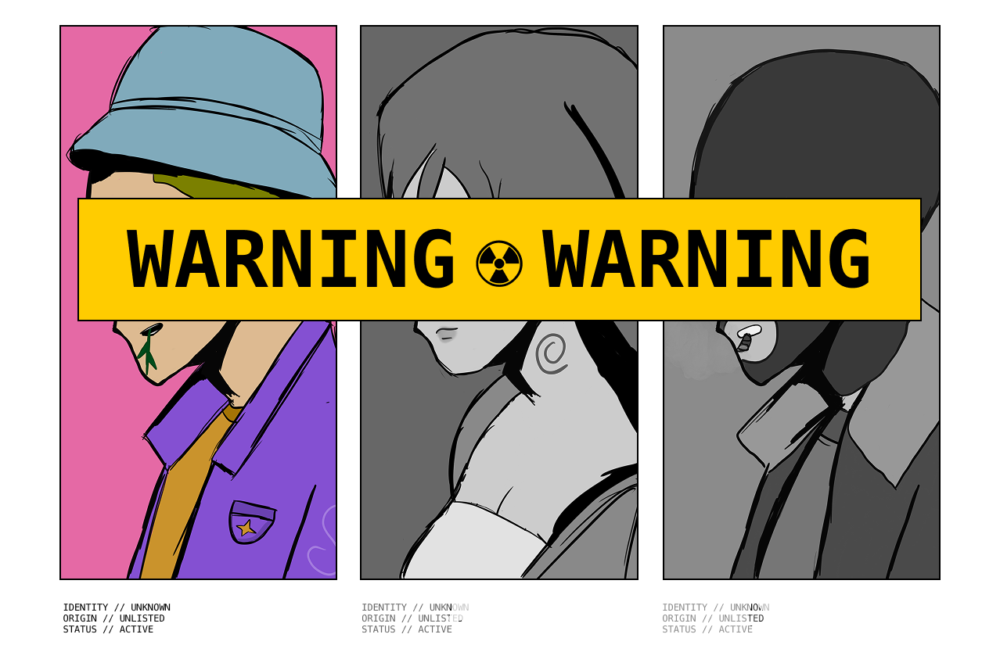
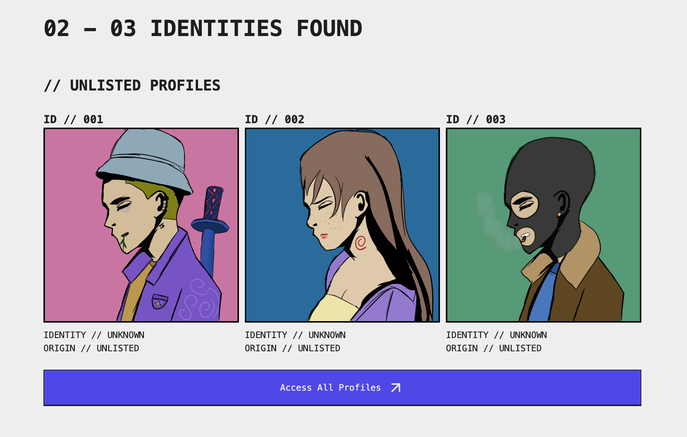
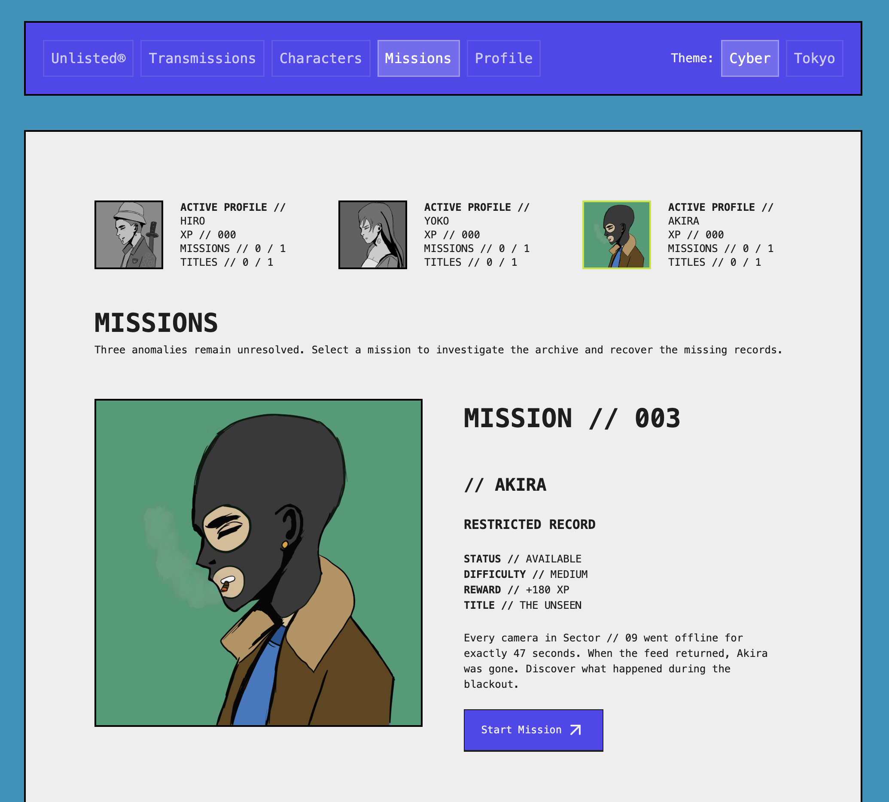
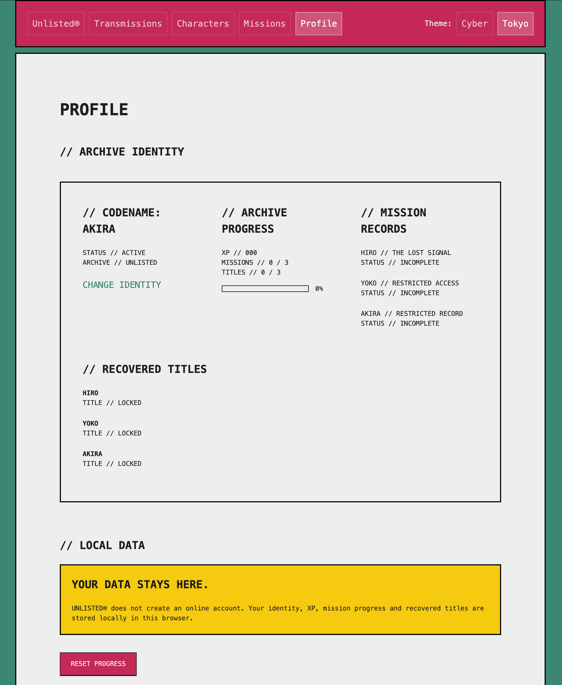

# UNLISTED®



> Three identities appeared where no record of them should exist.

UNLISTED® is an interactive web experience built around a corrupted digital archive.

Three unidentified profiles - Hiro, Yoko and Akira - appeared inside the archive with no known origin or history.

Explore their recovered profiles, investigate anomalies, complete missions and uncover fragments that were never supposed to exist.

## Official Teaser

[▶ Watch the UNLISTED® Official Teaser](https://youtu.be/yUE9JxkYgTc)

---

## About

UNLISTED® started as a personal project where I wanted to mix a few things I enjoy working on: design, development, illustration and interactive storytelling.

The idea was to create something that feels less like a traditional website and more like a system you've somehow gained access to.

The archive contains three unidentified characters, recovered transmissions and missing records. Each character has their own mission and their own piece of the story to uncover.

It's a small web experience, but I wanted every part of the interface to feel connected to the world of UNLISTED®.

---

## What's inside?

There are three character profiles to investigate:

**Hiro // ID 001**  
His movement record contains a missing trace that can still be recovered.

**Yoko // ID 002**  
She accessed a restricted sector without any registered authorization.

**Akira // ID 003**  
A hidden access record connects her to unexplained activity inside Sector // 09.

Each one has their own interactive mission.

Hiro's investigation takes place inside a terminal where you have to reconstruct a missing trace. Yoko's mission is based around reviewing security records and finding what caused an unauthorized access. Akira's mission asks you to reconstruct an access code from recovered fragments.

Completing missions gives you XP and unlocks titles that appear on your profile.

Your progress is saved directly in the browser with `localStorage`, so there's no account or login required.

---

## Design & Development

I designed UNLISTED® as both a visual and interactive project.

The neo-brutalist interface takes inspiration from archive systems, terminals and cyber interfaces. I also created the three character illustrations specifically for the project using Procreate.

On the development side, I built the experience with React, Vite and Tailwind CSS.

React Router handles the different sections and missions, while `localStorage` keeps track of completed missions, XP and unlocked titles.

I also built a small local admin tool to create, edit and delete transmissions while working on the project.

The project currently includes two visual themes - Cyber and Tokyo - as well as interactive background audio.

---

## Built With

`React` · `Vite` · `JavaScript` · `Tailwind CSS` · `React Router` · `Lucide React` · `React Icons` · `Sonner` · `Procreate`

---

## Screenshots

### Characters



### Missions



### Profile



---

## Run Locally

If you want to run the project locally:

```bash
npm install
npm run dev
```

---

## Current Version

**UNLISTED® // v1.0**

The first version includes three characters (for now 👀..), three interactive missions, transmissions, XP progression, unlockable titles, local progress saving and two visual themes.

---

## Credits

**Concept, Art Direction, UI/UX Design & Development**  
Nynerdly Visuals STUDIO

**Character Design & Illustrations**  
Created by Nynerdly Visuals using Procreate.

**Music used in the official teaser**  
“Digicore hyperpop elxnce type beat” - prod. star3d

---

## License

© 2026 Nynerdly Visuals STUDIO. All rights reserved.

UNLISTED® is shared publicly as a portfolio project.

The source code, visual identity, character designs, illustrations, narrative and original content may NOT be copied, redistributed or reused in another project without permission.